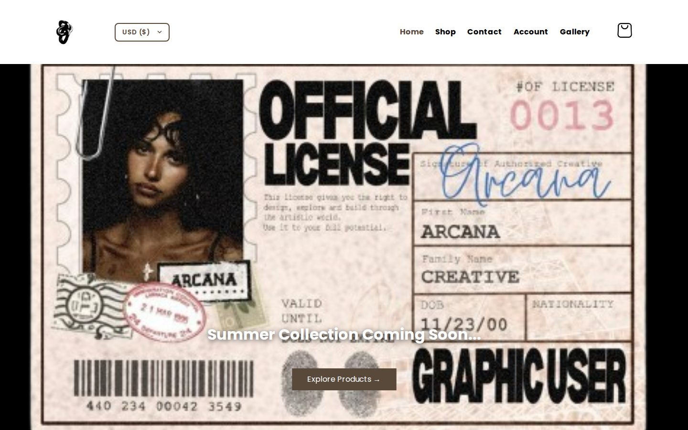
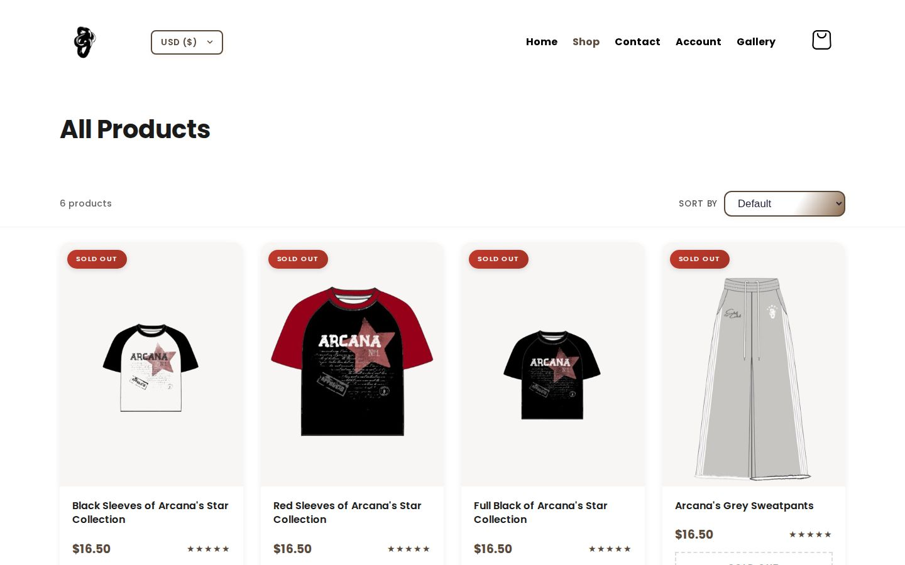
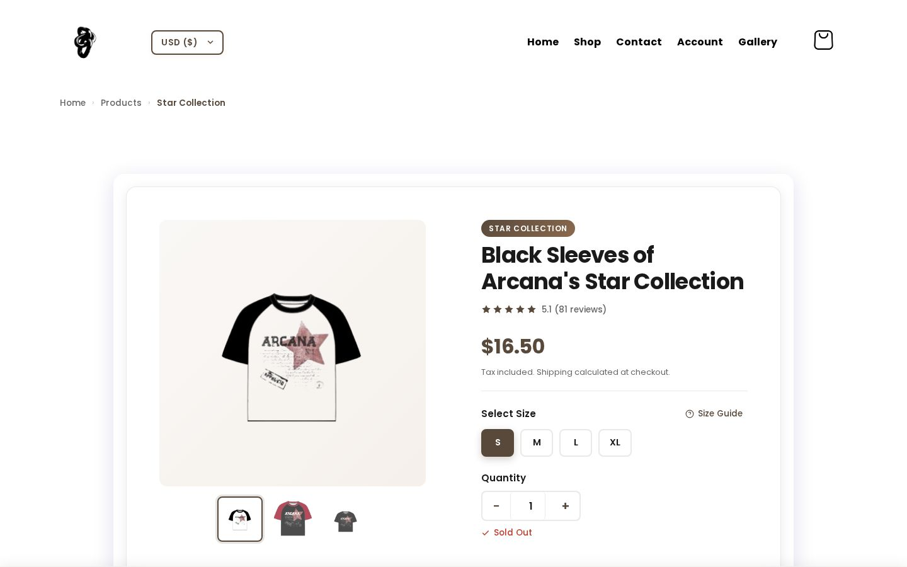
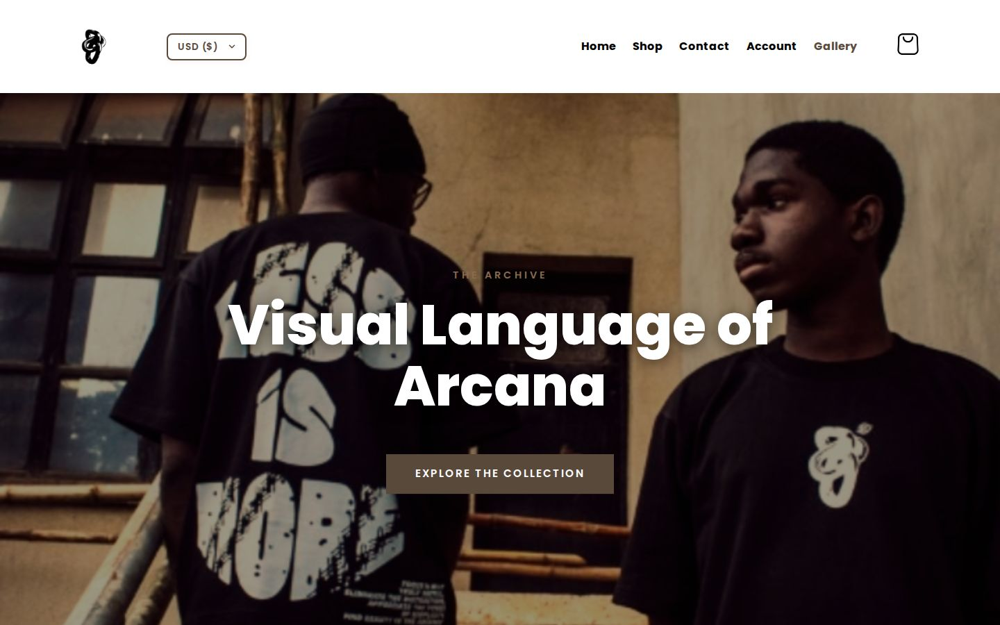
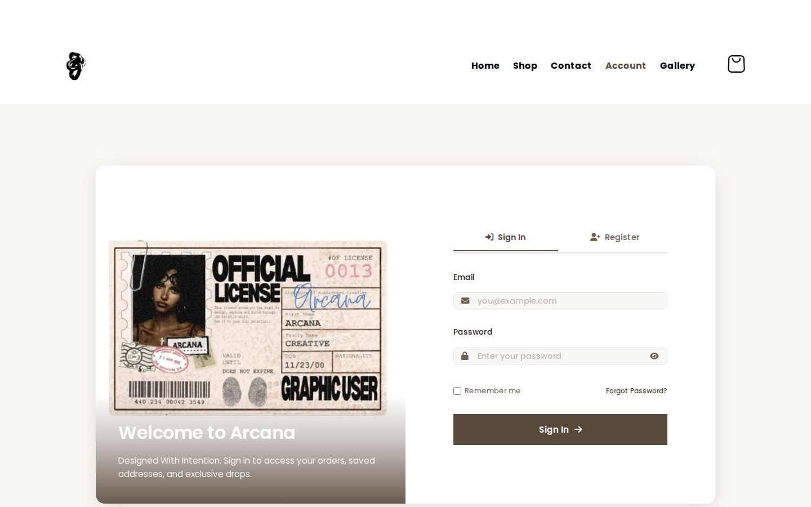
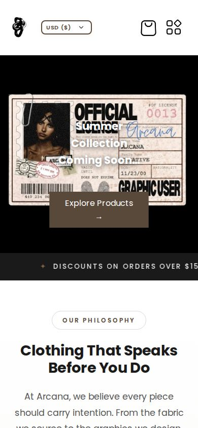

# Arcana

A static e-commerce storefront for a limited-drop fashion brand — built with plain HTML, CSS, and JavaScript, no framework required.

**Live demo:** [arcana-frontend-two.vercel.app](https://arcana-frontend-two.vercel.app/)

---

## What is Arcana?

Arcana is the frontend for a fashion brand that operates on a limited-drop model ("Designed With Intention"). The storefront handles the full customer journey: a pre-launch landing page with countdown, browsing a product catalogue, adding items to a cart, checking out via Paystack, and managing an account with order history and saved addresses.

The site is API-driven — all product data, cart state, orders, and user accounts live in a separate backend. The frontend communicates with that backend over HTTP and stores a JWT in `localStorage` for authenticated sessions.

---

## Features

- **Pre-launch landing page** — countdown timer, early-access newsletter signup, and social links; auto-redirects to the shop once the drop goes live
- **Product catalogue** — grid view of all products fetched from the API, with real-time "Sold Out" badges when stock reaches zero
- **Product detail page** — image gallery with zoom, size selector, size guide modal, quantity stepper, sticky add-to-cart bar, breadcrumb navigation, social share buttons, and a "You May Also Like" related-products section
- **Shopping cart** — server-side cart (per-user, persisted via API); quantity controls, item removal, and an order summary with shipping estimate
- **Checkout via Paystack** — validates address and phone before creating an order, then redirects to the Paystack payment page
- **User accounts** — register, log in, view profile, upload a profile picture, manage saved addresses, change password
- **Order tracking** — enter an order ID on `order_status.html` to fetch and display the current status from the API
- **Order history** — dashboard view of past orders with status badges (pending → processing → shipped → delivered)
- **Multi-currency display** — prices shown in USD, EUR, GBP, or NGN; selector persists in `localStorage`
- **Coupon code box** — a frontend-only placeholder UI at checkout; no backend coupon support is implemented yet
- **Responsive layout** — mobile-first design with a full-screen overlay menu on small screens
- **Toast notifications** — colour-coded feedback (success, error, warning, info) throughout the site
- **Gallery / lookbook** — editorial image grid
- **FAQ, Returns, Privacy Policy, Terms & Conditions** — static informational pages
- **Admin panel** — separate protected page for store administration (dashboard, orders, email broadcast)
- **Contact page** — enquiry form, email, WhatsApp, and business-hours info

---

## Tech stack

| Layer | Technology |
|---|---|
| Markup | HTML5 |
| Styles | CSS3 (single `style.css` + page-specific sheets) |
| Scripting | Vanilla JavaScript (ES6+) |
| Payment | [Paystack](https://paystack.com/) |
| Fonts | Google Fonts — Poppins |
| Icons | Font Awesome 6 |
| Backend | Separate REST API on Render (see [Configuration](#configuration)) |
| Hosting | Vercel |

No build tool, bundler, or JavaScript framework is used. Every page is a standalone HTML file.

---

## Project structure

```
arcana-frontend/
├── index.html                  # Pre-launch landing page with countdown & newsletter
├── shop.html                   # Main shop — featured collection + product grid
├── product.html                # Full product catalogue with sort/filter controls
├── product-detail.html         # Single product detail view
├── cart.html                   # Cart page with order summary and checkout
├── account.html                # Login / register page
├── account-dashboard.html      # Protected user dashboard (profile, orders, addresses)
├── edit-settings.html          # Edit profile and saved addresses
├── order_status.html           # Order tracking page
├── forgot_password.html        # Request a password-reset email
├── reset_password.html         # Set a new password via reset token
├── admin.html                  # Protected admin panel
├── contact.html                # Contact form + support info
├── gallery.html                # Editorial lookbook / image gallery
├── faqs.html                   # FAQ accordion
├── returns&exchanges.html      # Return and exchange policy
├── privacy-policy.html         # Privacy policy
├── terms&conditions.html       # Terms and conditions
│
├── script.js                   # Global utilities: toasts, mobile menu, cart badge,
│                               #   currency selector, newsletter wiring
├── cart.js                     # Cart page logic: render items, quantity updates,
│                               #   removal, Paystack checkout flow
├── account-dashboard-script.js # Dashboard: load profile, orders, addresses,
│                               #   profile-picture upload, logout
├── other-script.js             # Shared helpers used on simpler pages
│
├── style.css                   # Main stylesheet — layout, components, responsive
├── gallery.css                 # Gallery page styles
├── account-dashboard.css       # Dashboard page styles
│
└── *.png / *.jpeg              # Logo, product images, social icons, gallery photos
```

---

## Getting started

The project is a collection of static files — no build step required.

### Option A — VS Code Live Server (recommended for development)

1. Install the [Live Server](https://marketplace.visualstudio.com/items?itemName=ritwickdey.LiveServer) extension in VS Code.
2. Open the project folder, right-click `index.html`, and choose **Open with Live Server**.

### Option B — `npx serve`

```bash
npx serve .
```

Then open `http://localhost:3000` in your browser.

### Option C — any static HTTP server

Because the frontend reads product data and cart state from an external API, simply double-clicking an HTML file (the `file://` protocol) works for viewing static content but will hit CORS errors on API calls. Use a local server for any feature that involves the API.

---

## Configuration

The backend API URL is set directly in the JavaScript files:

| File | Variable | Default value |
|---|---|---|
| `cart.js` | `API_BASE` | `https://arcana-backend-master.onrender.com/api` |
| `account-dashboard-script.js` | `API_BASE` | `https://arcana-backend-master.onrender.com/api` |
| `script.js` | `API_BASE` | Falls back to `http://localhost:5000/api` when running on `localhost` |

To point the frontend at a different backend, update those constants. Do not commit real API keys or secrets to the repository.

The currency conversion rates (USD → EUR, GBP, NGN) are also hardcoded in `script.js`. They are display-only and do not affect the amount charged; payments are always processed in NGN via Paystack.

---

## How the cart works

1. A user must be logged in to use the cart. Visiting `cart.html` without a token redirects to the login page.
2. Cart state is stored server-side. `cart.js` fetches `/cart` on page load using the JWT from `localStorage`.
3. Quantity changes call `PUT /cart/{productId}`; item removal calls `DELETE /cart/{itemId}`.
4. On checkout, the page checks that the user has a saved address and phone number, then creates an order via `POST /orders` and initialises a Paystack transaction via `POST /paystack/initialize`, then redirects to the Paystack payment URL.

---

## How the account flow works

1. **Register / Log in** — `account.html` posts credentials to `/auth/register` or `/auth/login`. On success the JWT and email are stored in `localStorage` and the user is redirected to the dashboard (or the admin panel for admin accounts).
2. **Dashboard** — `account-dashboard.html` reads the token, fetches the user's profile, orders, and addresses from the API, and renders them.
3. **Session** — The token is stored in `localStorage`. There is no automatic refresh; when the token expires the user is redirected to log in again.
4. **Password reset** — `forgot_password.html` posts the user's email to `POST /auth/forgot-password`; `reset_password.html` reads a token from the URL and posts the new password to `POST /auth/reset-password/{token}`.
5. **Settings** — `edit-settings.html` lets a logged-in user update their profile (`PUT /auth/profile`) and change their password (`PUT /auth/change-password`).

---

## Deployment

The frontend is deployed on [Vercel](https://vercel.com/) directly from this repository. Because every page is a static HTML file there is no build command — Vercel serves the root of the repository as-is.

To deploy your own fork:

1. Import the repository in the Vercel dashboard.
2. Leave the **Build Command** blank (or set it to empty).
3. Set the **Output Directory** to `.` (root).
4. Deploy.

---

## Screenshots

| | |
|---|---|
|  |  |
| *Shop — hero and featured collection* | *Product catalogue — all 6 products* |
|  |  |
| *Product detail — size selector, zoom, and sticky cart bar* | *Gallery — "Visual Language of Arcana" lookbook* |
|  |  |
| *Account — sign in / register* | *Shop on a 390 px mobile viewport* |

---

## Contributing

Contributions are welcome. Please read [CONTRIBUTING.md](CONTRIBUTING.md) before opening a pull request.

---

## License

[MIT](LICENSE) © 2026 ITSYABOINEUTRAL

---

## Known limitations / roadmap

The following are real gaps in the current codebase that are good candidates for contribution:

- **Incorrect shipping rate in cart** — `cart.js:62` charges $5.00 for Nigeria shipping; the correct rate is $3.50 (matching `product-detail.html:712`).
- **Multiple `<base target="_blank">` tags** — all 18 HTML files contain at least one `<base target="_blank">` tag, with a total of 60 across the repo. Only the first `<base>` element is used by browsers; having one at all causes links without an explicit `target` attribute to open in new tabs unintentionally.
- **No order confirmation on return from Paystack** — Paystack redirects back to `index.html` with `reference` and `trxref` query parameters, but `index.html` ignores them; returning customers see the landing page with no acknowledgement.
- **Currency conversion rates are hardcoded** — they drift from market rates and must be updated manually in `script.js`.
- **No automated tests** — there are no unit or integration tests for any of the JavaScript modules.
- **Accessibility gaps** — cart quantity `+`/`−` buttons have no `aria-label`; the quantity span has no `aria-live`; `other-script.js` toast is missing `aria-live`.
- **No input sanitisation on the frontend** — the contact form and settings form do not validate or sanitise fields before submitting.
- **Inline styles in HTML files** — `account-dashboard.html`, `shop.html`, `edit-settings.html`, and others contain large `<style>` blocks; these should be moved to the shared stylesheet.
- **`API_BASE` is duplicated** across multiple files — a single shared config module would reduce drift.
- **No 404 page** — navigating to a nonexistent URL shows a blank Vercel error page.
